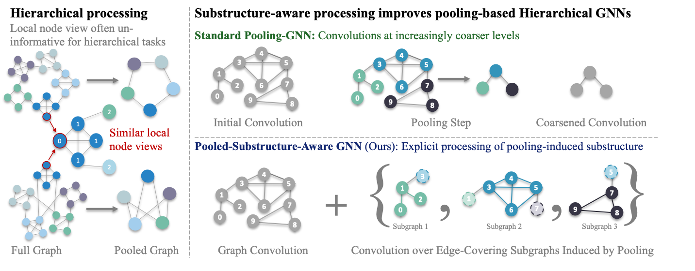

# PSA-GNN

**Hierarchical Graph Representation Learning with Pooling-Induced Substructures**  
Luca Sbicego · Xiaowen Dong · Dorina Thanou  
**NeurIPS 2026**



PSA-GNN preserves pooling-induced subgraphs and combines message passing inside
those subgraphs with message passing on the original graph. IP-GNN processes
clusters before pooling; Pool-GNN immediately coarsens them. The repository also
provides two controlled hierarchical benchmarks and nested-SBM structural descriptors.

## Installation

Use Python 3.11 in a fresh environment, then install the requirements:

```bash
pip install -e . -r requirements.txt
```

For CUDA, select matching PyTorch and PyG wheel sources in `requirements.txt` using the
[PyG installation guide](https://pytorch-geometric.readthedocs.io/en/2.7.0/install/installation.html).

For hierarchy characterization, additionally install graph-tool in the same environment:

```bash
conda install -c conda-forge graph-tool
```

## Run models and experiments

These single-seed examples run our models on COLLAB, using Leiden substructures for PSA-GNN, IP-GNN, and Pool-GNN. Model code is in [src/models](src/models/) and experiment settings are set with Hydra in [conf](conf/). Training curves are logged to WandB by default. Outputs are written under `OUT/train/`.

```bash

# PSA-GNN
python main.py dataset=collab model=psa_gnn model.conv_type=GIN subgraph_policy=leiden experiment.seed=1 dataset.model_params.hidden_dim=130 dataset.model_params.encode_subgraph_size=false

# IP-GNN
python main.py dataset=collab model=ip_gnn model.conv_type=GIN subgraph_policy=leiden subgraph_policy.khop=0 experiment.seed=1 model.number_initial_mp=2 model.number_within_mp=2 model.number_post_mp=2 dataset.model_params.hidden_dim=184

# Pool-GNN
python main.py dataset=collab model=pool_gnn model.conv_type=GIN subgraph_policy=leiden subgraph_policy.khop=0 experiment.seed=1 model.number_initial_mp=3 model.number_within_mp=0 model.number_post_mp=3 dataset.model_params.hidden_dim=184

# MPNN (GIN)
python main.py dataset=collab model=mp_gnn model.conv_type=GIN subgraph_policy=whole_graph experiment.seed=1 dataset.model_params.hidden_dim=184
```

To run our experiments on BREC with `python run_brec.py`, extract `brec_v3.npy` from [BREC_data_all.zip](https://github.com/GraphPKU/BREC/blob/Release/BREC_data_all.zip) and place it at `data/BREC/raw/brec_v3.npy` (or `$DATA_ROOT/BREC/raw/brec_v3.npy` if `DATA_ROOT` is set).


## Synthetic hierarchical datasets


**Macro-Hierarchies** distinguishes ring versus bipartite macro-community connectivity.
**Granular-Hierarchies** distinguishes even versus uneven cluster sizes. Both use
constant node features by default. Each difficulty uses the original layout:

```text
macro/easy/
  raw/graph_1.pt
  ...
  manifest.json       # optional metadata and checksums
```

See the [dataset notebook](notebooks/synthetic_hierarchical_data.ipynb) for generation,
visualization, and loading examples.

### Download from Hugging Face

Download a dataset directly from Hugging Face:

```python
from src.datasets import SyntheticHierarchicalData

dataset = SyntheticHierarchicalData.from_huggingface(
    "lsbicego/psa-gnn-hierarchies",
    subfolder="macro/easy",
)
```


### Load from disk

Existing per-graph datasets can be loaded similarly: 

```python
from src.datasets import SyntheticHierarchicalData
from torch_geometric.loader import DataLoader

dataset = SyntheticHierarchicalData("data/macro-demo")  # directory containing raw/
graph = dataset[0]                                     # ordinary PyG Data
batch = next(iter(DataLoader(dataset, batch_size=4)))
```

### Generate new graphs

You can generate your own synthetic hierarchical datasets with the code supplied in `src/` with the following script: 

```bash
python scripts/prepare_synthetic_data.py generate --dataset macro --output data/macro-demo --num-graphs 8 --seed 42
python scripts/prepare_synthetic_data.py generate --dataset granular --output data/granular-demo --num-graphs 8 --seed 42
```

Generator parameters can be supplied
with `--parameter`, for example `--parameter delta_macro=0.005` for Macro or
`--parameter p_out_base=0.01` for Granular. 


## Characterize graph hierarchy

For example, first generate `data/macro-demo` using the command above, then:

```python
from src.hierarchy import compute_hierarchy_stats, NestedSBMStats
from src.datasets import SyntheticHierarchicalData
from torch_geometric.loader import DataLoader

dataset = SyntheticHierarchicalData("data/macro-demo")
graph = dataset[0]
stats = compute_hierarchy_stats(graph, seed=42)
print(stats["substructure_count"], stats["substructure_depth"])

characterized = SyntheticHierarchicalData(
    "data/macro-demo",
    pre_transform=NestedSBMStats(seed=42),
    processed_root="data/macro-with-stats",
)
batch = next(iter(DataLoader(characterized, batch_size=4)))
print(batch.substructure_count, batch.substructure_depth)
```

You can also check out the [hierarchy notebook](notebooks/hierarchy_characterization.ipynb) for more examples.

## Citation

```bibtex
@inproceedings{sbicego2026hierarchical,
  title={Hierarchical Graph Representation Learning with Pooling-Induced Substructures},
  author={Sbicego, Luca and Dong, Xiaowen and Thanou, Dorina},
  booktitle={Advances in Neural Information Processing Systems},
  year={2026}
}
```
